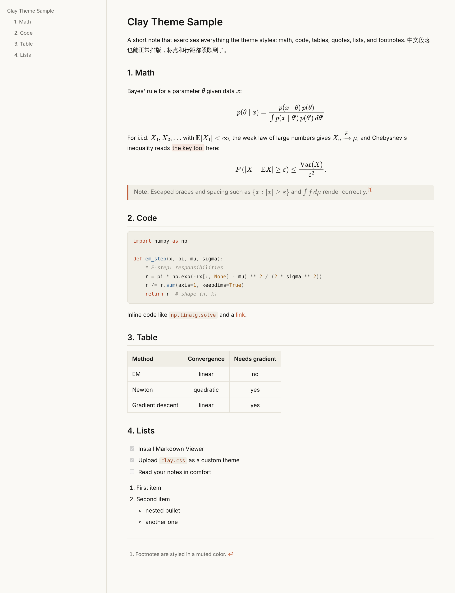
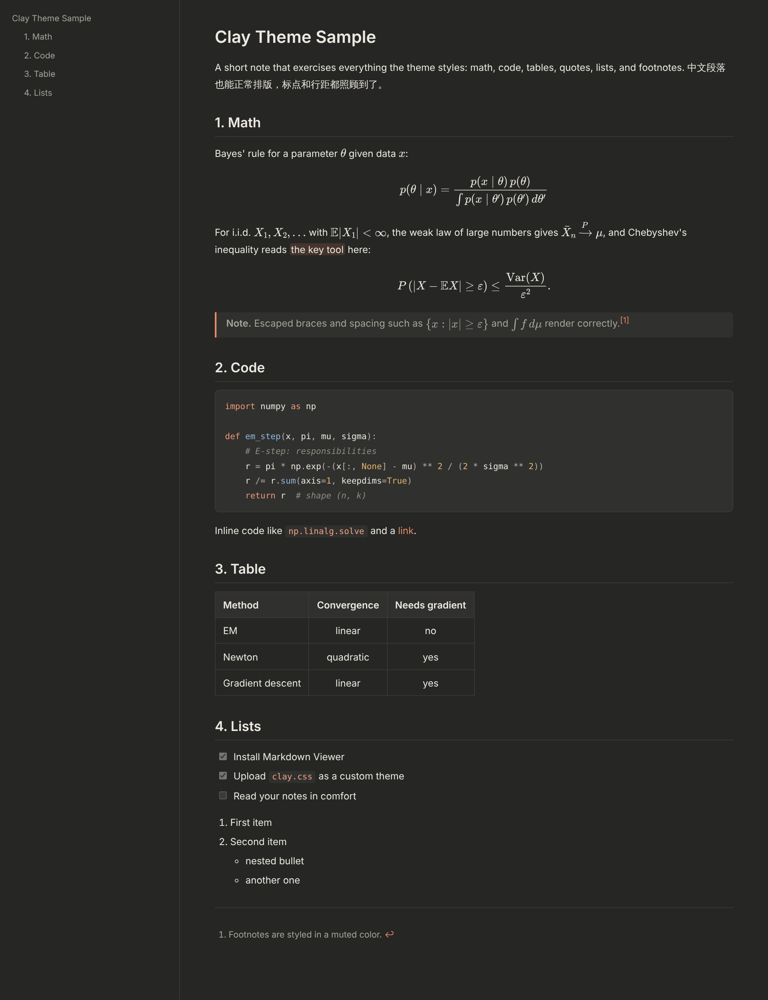

# Clay

A warm, paper-like theme for the [Markdown Viewer](https://github.com/simov/markdown-viewer) browser extension, tuned for math-heavy notes. It switches between a soft off-white and a warm dark gray with your system's appearance.

[中文说明](#中文说明)

| Light | Dark |
| :---: | :---: |
|  |  |

## Features

- **Follows your system.** Light and dark palettes switch automatically with macOS / Windows appearance.
- **Readable line length.** With Content Width set to `AUTO`, text is capped at 920px and centered. Other width options still work.
- **Math-friendly.** Calm heading sizes, comfortable line height, and long display formulas scroll horizontally instead of overflowing.
- **Self-contained syntax colors.** Code highlighting is defined by the theme itself, so code stays readable even when the extension loads the code palette for the wrong color scheme (for example after switching appearance without reloading the page).
- **Small.** About 5 KB after minification, well within the extension's 8 KB limit for custom themes.

## Install

1. Install [Markdown Viewer](https://chromewebstore.google.com/detail/markdown-viewer/ckkdlimhmcjmikdlpkmbgfkaikojcbjk) and, for local files, turn on **Allow access to file URLs** in `chrome://extensions` → Markdown Viewer → Details.
2. Download [`clay.css`](clay.css) (open it, then use the download button, or save the raw file).
3. Click the extension icon → **Advanced Options** → **Settings**.
4. Set **Content Theme** to `CUSTOM`, upload `clay.css`, and set **Color Scheme** to `AUTO`.
5. Reload any open Markdown page.

### Recommended settings

| Section | Option | Value |
| --- | --- | --- |
| Content | `mathjax`, `toc`, `autoreload`, `syntax` | on |
| Compiler (markdown-it) | `cjk`, `footnote`, `mark`, `tasklists` | on |
| Theme | Content Width | `AUTO` |

Want smaller text? Press <kbd>Cmd</kbd> + <kbd>-</kbd> (or <kbd>Ctrl</kbd> + <kbd>-</kbd>) on a Markdown page. Chrome remembers the zoom level for local files.

## Known limitation

Formulas inside headings appear as raw TeX (for example `$L^p$`) in the table of contents sidebar. The extension intentionally skips math rendering there, so a theme cannot change it.

## Try it

Open [`sample.md`](sample.md) in Chrome with the theme installed. It covers math, code, tables, quotes, task lists, and footnotes.

## Credits

The palette is inspired by the warm look of Anthropic's Claude interface. This is an independent community project and is not affiliated with or endorsed by Anthropic.

## License

[MIT](LICENSE)

---

## 中文说明

Clay 是给浏览器扩展 [Markdown Viewer](https://github.com/simov/markdown-viewer) 用的一个暖色调主题，专门照顾公式多的笔记。浅色模式是米白纸张色，深色模式是暖深灰，会跟着系统外观自动切换。

### 特点

- **跟随系统**：系统切换深色、浅色时，主题自动切换配色
- **行宽适中**：Content Width 设为 `AUTO` 时，正文最宽 920px 并居中；选其他宽度时按你的设置来
- **适合公式**：标题大小克制、行距舒适，很长的行间公式会横向滚动，不会撑破页面
- **代码配色自带**：代码高亮的颜色由主题自己定义，就算扩展加载了另一种明暗的代码配色（比如切换系统外观后没刷新页面），代码也依然清晰可读
- **体积小**：压缩后约 5KB，在扩展 8KB 的自定义主题限制以内

### 安装

1. 安装 [Markdown Viewer](https://chromewebstore.google.com/detail/markdown-viewer/ckkdlimhmcjmikdlpkmbgfkaikojcbjk)。如果要看本地文件，到 `chrome://extensions` → Markdown Viewer → 详情，打开“允许访问文件网址”
2. 下载 [`clay.css`](clay.css)
3. 点击扩展图标 → **Advanced Options** → **Settings**
4. 把 **Content Theme** 设为 `CUSTOM`，上传 `clay.css`，**Color Scheme** 选 `AUTO`
5. 刷新已经打开的 Markdown 页面

### 推荐设置

| 区域 | 选项 | 设置 |
| --- | --- | --- |
| Content | `mathjax`、`toc`、`autoreload`、`syntax` | 打开 |
| Compiler（markdown-it） | `cjk`、`footnote`、`mark`、`tasklists` | 打开 |
| Theme | Content Width | `AUTO` |

觉得字大？在 Markdown 页面按 <kbd>Cmd</kbd> + <kbd>-</kbd> 缩小即可，Chrome 会记住本地文件的缩放比例。

### 已知限制

标题里的公式在左侧目录中会显示成原始写法（比如 `$L^p$`）。这是扩展特意不在目录里渲染公式，主题改变不了。

### 致谢

配色灵感来自 Anthropic 的 Claude 界面。本项目是独立的社区作品，与 Anthropic 无关，也未获其认可。
